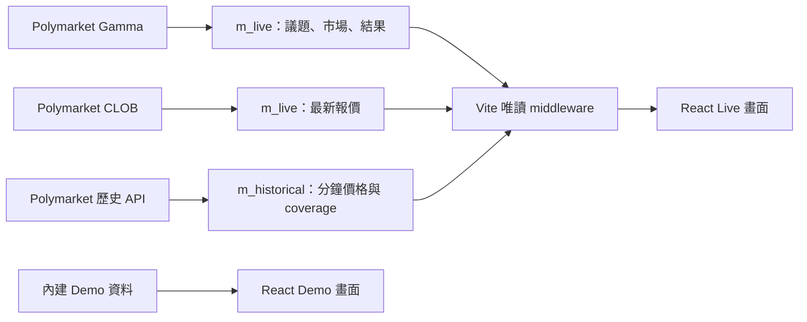

# LAC · Prediction terminal

LAC 的本機預測市場 Demo：以同一套畫面展示範例資料與 Polymarket 真實行情，包含市場瀏覽、歷史走勢、訊號定位，以及推薦分成與設定頁。

這個 repository 同時包含 **React 前端 `lac_web`** 與 **Python 資料程式 `lac_data`**。Live 模式讀取本機 PostgreSQL；帳號、付款、錢包連線與下單尚未接入正式服務。

[快速啟動](#快速啟動) · [首次安裝](#首次安裝) · [資料與程式結構](#資料與程式結構) · [歷史資料](#歷史資料) · [開發與檢查](#開發與檢查)

## Demo 與 Live

| 功能                       | Demo                                         | Live                                           |
| -------------------------- | -------------------------------------------- | ---------------------------------------------- |
| Prediction                 | 內建議題、價格與模擬走勢                     | 從 PostgreSQL 讀取 Polymarket 議題、報價與歷史 |
| Signal                     | 範例訊號；點選後定位市場並標黃對應的 Yes／No | 顯示 `No LAC signals in Live demo`             |
| Referral rewards           | 可調整代理比例，立即重算收入與分成           | 同一套 Demo 互動                               |
| Settings                   | 推薦碼、錢包連線狀態與 API 欄位展示          | 同一套 Demo 互動                               |
| Products／Buy USDT／Stocks | 方案與介面展示；Stocks 為佔位頁              | 同一套 Demo 內容                               |

Demo 與 Live 共用 Sidebar、EventCard、EventDetail、PriceChart、MarketsTable。Live 沒有比分或報價資料時，不以 Demo 值補上。

## 快速啟動

以下是**已完成首次安裝**的 Windows + WSL 操作。既有工作目錄為 `/home/admin/web`。

### 1. Windows 開啟 WireGuard VPN

此本機環境透過 VPN 連接 Polymarket API。先開啟 WireGuard，再以 PowerShell 確認隧道為 `Up`：

```powershell
Get-NetAdapter | Where-Object { $_.InterfaceDescription -match 'WireGuard' } |
  Select-Object Name,InterfaceDescription,Status
```

### 2. WSL 終端一：市場與報價

```bash
export PATH="/home/admin/.local/bin:$PATH"
cd /home/admin/web/lac_data/python
uv run --env-file ../../.env python -m m_live.all_runtime
```

Gamma 與 CLOB 分別在獨立進程執行，正常情況以 600 秒為週期；單一單位不重疊，執行超過週期時完成後立即開始下一輪。

### 3. WSL 終端二：網站

```bash
export PATH="/home/admin/.local/bin:$PATH"
cd /home/admin/web/lac_web
npm run dev
```

開啟 [http://127.0.0.1:5173/prediction](http://127.0.0.1:5173/prediction)，在 Logo 旁切換 **Demo／Live**。兩個終端機保持開啟。

**共用環境檔位於 repository 根目錄。** 從 `lac_data/python` 啟動時使用 `../../.env`；前端伺服器會自動讀取父層的 `.env`。

- 只看 Demo：啟動網站即可，不需要啟動爬蟲或連接 Polymarket；網站啟動仍需根目錄的五個 `DB_*` 設定。
- 已有資料：Live 可立即展示已保存的內容，之後由爬蟲更新。
- 空資料庫：先等 Gamma 發布完整名單；CLOB 讀已發布名單，首次報價可能要等下一個 600 秒週期。
- 停止：在各自終端按 `Ctrl+C`。爬蟲會要求各單位完成當前工作後退出，可能需要等待。

## 首次安裝

### 環境需求

| 工具         | 要求                                                 |
| ------------ | ---------------------------------------------------- |
| 作業環境     | Windows + WSL；目前本機使用 Ubuntu 24.04             |
| Python       | 3.12 以上，由 `uv` 管理依賴                          |
| Node.js／npm | 目前本機使用 Node.js 24／npm 11                      |
| PostgreSQL   | **16**，本機連接埠 **5432**，資料庫名稱 **lac_data** |
| 網路         | 抓取 Polymarket 資料時開啟 WireGuard VPN             |

程式會檢查 PostgreSQL 主版本、連接埠與資料庫名稱。資料庫角色需能連接 `postgres` 與 `lac_data`、建立／使用專案 schema；空庫首次初始化還需要建立資料庫的權限。

若尚未有本機 checkout：

```bash
git clone git@github.com:LightingArb/lac.git /home/admin/web
```

此為私人 repository，clone 需要已獲授權的 GitHub SSH 金鑰。已有 checkout 時直接使用原目錄。

### 安裝依賴

```bash
export PATH="/home/admin/.local/bin:$PATH"
cd /home/admin/web/lac_data/python
uv sync --locked

cd /home/admin/web/lac_web
npm ci
```

### 共用環境與資料表

根目錄 `.env` 由資料程式與前端伺服器共用，只保留這一份：

| 變數          | 用途                 |
| ------------- | -------------------- |
| `DB_HOST`     | 本機 PostgreSQL 位址 |
| `DB_PORT`     | `5432`               |
| `DB_NAME`     | `lac_data`           |
| `DB_USER`     | 已配置的資料庫角色   |
| `DB_PASSWORD` | 該角色的密碼         |

本私人 repository 依專案規範追蹤根目錄 `.env`；本文件不重複列出憑證值。前端的 `DB_*` 是伺服器設定，不使用 `VITE_` 前綴，也不傳給瀏覽器。

在 PostgreSQL 與角色已就緒後，初始化兩個 schema：

```bash
cd /home/admin/web/lac_data/python
uv run --env-file ../../.env python -m m_live.all_setup
uv run --env-file ../../.env python -m m_historical.all_setup
```

正常輸出：

```text
SETUP_OK m_live tables=4
SETUP_OK m_historical tables=2
```

Setup 建立缺少的宣告物件，重跑會檢查既有欄位與型別；遇到結構不符會報錯，不會自動遷移。完成後依「快速啟動」開啟兩個終端機。

## 資料與程式結構



```text
.
├── README.md
├── AGENTS.md
├── .env
├── .gitignore
├── lac_data/
│   └── python/
│       ├── pyproject.toml
│       ├── uv.lock
│       ├── h_shared/          # DB、排程、HTTP 重試與限流
│       ├── m_live/            # Gamma metadata、CLOB 最新報價
│       └── m_historical/      # 手動歷史快照
└── lac_web/
    ├── server/live.ts         # Vite 的唯讀 DB 查詢
    ├── src/                   # React 頁面、共用元件、Demo fixtures
    ├── tests/                 # 資料對應與 Demo 規則測試
    └── README.md              # 前端開發導覽
```

### 資料表

| Schema         | 資料表                                                     | 內容                                                  |
| -------------- | ---------------------------------------------------------- | ----------------------------------------------------- |
| `m_live`       | `m01_gamma_event`、`m01_gamma_market`、`m01_gamma_outcome` | 議題、市場、結果與來源識別碼                          |
| `m_live`       | `m02_clob_price`                                           | 各 asset 的 bid、ask、midpoint、last trade 及觀測時間 |
| `m_historical` | `m01_polymarket_price`                                     | 來源實際回傳的分鐘歷史價格                            |
| `m_historical` | `m01_polymarket_coverage`                                  | 資產的請求時間窗、狀態與點數                          |

欄位定義見 [m_live SQL](lac_data/python/m_live/sql/) 與 [m_historical SQL](lac_data/python/m_historical/sql/)。瀏覽器只透過 [server/live.ts](lac_web/server/live.ts) 讀表，前端不觸發爬蟲運算。

### Live 畫面的資料規則

- Trending：進行中議題依 24h 成交量取前 100 個，每頁 50 個；大型議題的市場亦每頁 50 個。
- 固定分類：Trending、Politics、Sports、Finance、Crypto、Esports、Geopolitics、Weather。七個來源分類各使用同名 Polymarket slug。
- 卡片價格與 Chance：`midpoint`；倍數：`1 / midpoint`。
- Yes／No 買價：各自結果 asset 的 `best_ask`；缺值顯示「—」。
- Hide low-liquidity：隱藏 liquidity 小於 25,000 或未知的市場；已選訊號對應列保留可見。
- 議題列表與詳情在分頁可見時每 30 秒重新讀表；這是畫面刷新頻率，與爬蟲的 600 秒週期不同。
- 歷史圖按來源時間繪製，不補缺少的分鐘；圖表顯示保存快照的 UTC 時間窗。

## 歷史資料

歷史回補是手動單次工作，**不隨 `m_live` 自動更新**。預設取執行時 24h 成交量前 500 個進行中議題的所有具 asset ID 結果，包含其已關閉子市場，抓取固定三天窗。

```bash
cd /home/admin/web/lac_data/python
uv run --env-file ../../.env python -m m_historical.all_runtime --once --days 3 --top-events 500
```

未提供 `--end` 時，以啟動當下的 UTC 分鐘固定結束時間。需要可重跑的同一時間窗時，可先保存結束時間：

```bash
LAC_HISTORY_END=$(date -u +%Y-%m-%dT%H:%M:00Z)
printf '%s\n' "$LAC_HISTORY_END"
uv run --env-file ../../.env python -m m_historical.all_runtime \
  --once --days 3 --top-events 500 --end "$LAC_HISTORY_END"
```

中斷後使用**原本的** `--days`、`--top-events` 與 `--end` 重跑，不重新計算結束時間；另開終端時，把已保存的時間填回 `LAC_HISTORY_END`。程式會跳過該時間窗已成功處理的資產。歷史不涵蓋全部議題，空資料或錯誤會如實顯示。

## 開發與檢查

前端：

```bash
cd /home/admin/web/lac_web
npm test
npm run build
```

`npm test` 驗證 Live 欄位對應、缺值、結果排序、代理分成與推薦碼規則；`npm run build` 執行 TypeScript 檢查並產生 `dist/`。

Python：

```bash
cd /home/admin/web/lac_data/python
uv run pytest
uv run ruff check .
uv run ruff format --check .
```

前端的元件、路由與響應式設計見 [lac_web/README.md](lac_web/README.md)。協作入口見 [AGENTS.md](AGENTS.md)。

## Demo 範圍與常見問題

- **沒有真實交易：** Sign in、Subscribe、Redeem、Telegram 綁定與 Yes／No 下單按鈕尚未接入服務；Live 不計算 LAC fair／EV 或產生真實訊號。
- **推薦分成為範例：** 官方比例 20%、自己的比例 80%；可將直接下層代理設定為 0–80 整數。推薦碼與代理比例在目前頁面記憶體中，重新整理會重設。
- **錢包與 API 欄位為展示：** Connect wallet 只切換 Demo 狀態；Save API key 清空輸入，不儲存或傳送憑證。語言／主題選項僅切換狀態，尚無完整翻譯或深色配色。
- **Live 在 preview 無法載入：** Live middleware 僅由 `npm run dev` 提供；`npm run preview` 或單獨開啟 `dist/` 不提供 DB 查詢。
- **網站無法啟動或 Live 連線失敗：** 先檢查根目錄 `.env` 的五個欄位、PostgreSQL 16／5432、兩個 setup 結果；Vite 固定使用 5173，埠已被占用時會直接報錯。
- **API 連線失敗：** 確認 WireGuard 已開啟，並查看爬蟲終端的 `provider_error`。HTTP 401／403 會暫停該單位，原因處理好後再重新啟動。
- **Live 價格或歷史尚未更新：** 讀表成功不表示來源資料已刷新；確認爬蟲的 `published`／`round_finished` 紀錄。歷史則需另外執行回補。
